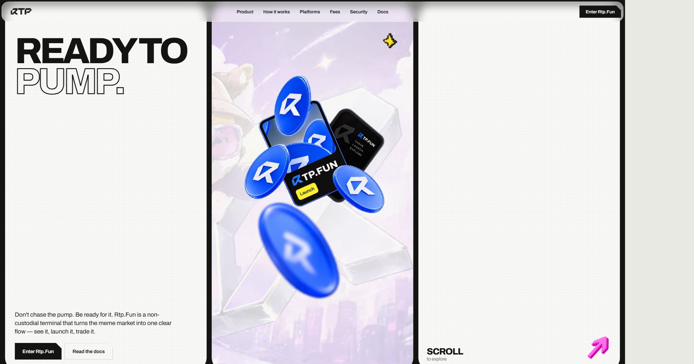
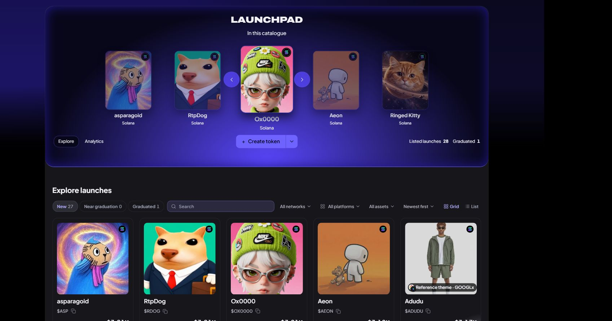
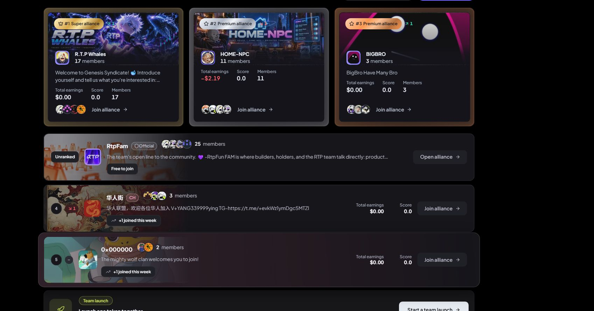

  

# RTP.FUN — Markets, token launches and community alliances

RTP.FUN brings market discovery, trading, token launches and community alliances into one web app. Follow market and social activity, explore launches, and work with your alliance without losing the context behind an action.

[Open RTP.FUN](https://rtp.fun/app/) · [Read the user guide](https://rtp.fun/docs/) · [Explore Alliances](https://rtp.fun/app/community) · [Release notes and scope](STATUS.md)

## Explore the product

| Start with | What you can find | Open |
| --- | --- | --- |
| Market discovery | Pulse market views, Signals updates, Calls and tracking surfaces. | [Pulse](https://rtp.fun/app/pulse) · [Signals](https://rtp.fun/app/signals) |
| Trading | Trade and Swap workflows with amounts, fees and execution review; Portfolio for account context. | [Trading guide](https://rtp.fun/docs/using/trade/) |
| Token launches | A launch catalogue and token-creation workflows, with availability specific to each network and route. | [Launchpad](https://rtp.fun/app/launch) |
| Community alliances | A public directory, alliance membership, Calls and task bounties for community work. | [Alliances](https://rtp.fun/app/community) |
| More to explore | Public Live and Gacha directories alongside the market and community features. | [Live](https://rtp.fun/app/live) · [Gacha](https://rtp.fun/app/gacha) |

Communities have a place to keep their identity, share Calls and organize work. Traders can follow the activity around an asset and move into its trading or launch workflow. A listed asset, community or third-party post is not an RTP.FUN endorsement.

### The current interface

<table>
<tr>
<td width="50%">
  
   <strong>Launchpad</strong> 
  Explore listed launches and network filters.
</td>
<td width="50%">
  
   <strong>Alliances</strong> 
  Find communities and explore their shared activity.
</td>
</tr>
</table>

These are real public page captures from **24 October 2026**. They exclude the account header, wallet balances and private drafts. Listed assets, community statistics and third-party content are historical screen content, not current quotes or performance claims. [Image provenance and sizes](assets/README.md).

## Start with the right context

1. **Explore before connecting.** Use the public market, launch and community pages to understand the product.
2. **Learn the Wallet roles.** Login establishes your RTP.FUN account. The execution wallet, called AMS in the architecture documentation, signs supported transactions in the user's browser. [Wallet guide](https://rtp.fun/docs/using/wallet/).
3. **Review the specific action.** Network, route, asset, amount and fees matter. A visible route or tool does not establish that every path has been exercised in production.
4. **Check the result before repeating an action.** A transaction with an uncertain outcome needs verification; uncertainty is not confirmation of failure.

Some product surfaces are still incomplete, and market data or external services can be unavailable. Feature visibility, interface checks and completed on-chain execution are different kinds of evidence. The [dated release note](evidence/releases/2026-10-24/README.md) explains the scope of the latest published observations. No new funds were moved for that review.

## Wallet and public security information

Identity and transaction signing are separate roles. RTP.FUN's server prepares and relays supported transactions; the intended signing boundary keeps plaintext AMS keys out of the server. The [public architecture](ARCHITECTURE.md) and [AMS profile](docs/ams/README.md) describe these responsibilities and their limits.

This repository does not publish an independent security assessment or certification. Architecture descriptions and internal checks do not establish either. [Evidence vocabulary](docs/assurance/README.md) · [Responsible disclosure](SECURITY.md).

## About this repository

This is RTP.FUN's public product and documentation repository. The running application and its private source are maintained separately; this repository has no application install or build step.

| Read | Purpose |
| --- | --- |
| [Official Docs](https://rtp.fun/docs/) | How to use the product |
| [Product overview](PRODUCT.md) | Product areas and the language used to describe them |
| [Status and limitations](STATUS.md) | Dated observations and how to read capability claims |
| [Public architecture](ARCHITECTURE.md) | Identity, signing and server responsibilities |
| [Security policy](SECURITY.md) | Reporting a security concern privately |
| [Claims registry](claims/) | Scoped product and architecture statements |
| [Publication policy](PUBLICATION_POLICY.md) | What is appropriate to publish |
| [Contributing](CONTRIBUTING.md) | Documentation corrections and public feedback |

The [token transparency framework](docs/token/fair-launch-principles.md) records disclosure principles only. It is not a sale announcement, a published token allocation, an airdrop entitlement or a promise of token-holder income.
